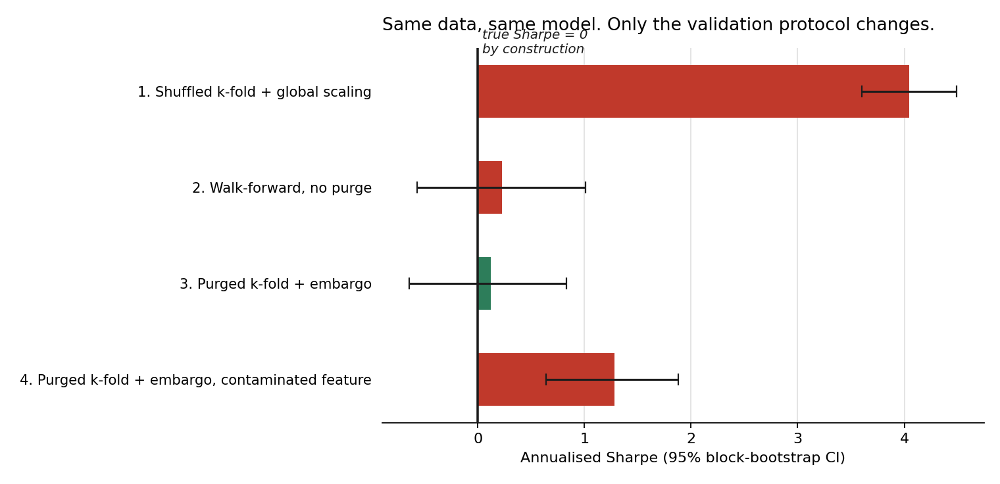

# Leakage Audit: measuring how much your validation protocol lies to you

**The data has no predictable structure. One protocol reports a Sharpe above 4 anyway.**

This project builds a price series whose returns are unpredictable *by construction* —
written down as a generating process, zero conditional mean, no autocorrelation — and
then runs four validation protocols against identical data, identical features, and an
identical model. The only thing that changes between rows is how the data was split.

Since the true out-of-sample edge is exactly zero, every point of reported edge is a
direct measurement of contamination.

---

## Result

`python -m src.experiment --n 20000 --horizon 24`, 19,905 observations:

| Protocol | AUC | Sharpe | 95% CI | Train rows contaminated |
|---|---|---|---|---|
| 1. Shuffled k-fold + global scaling | 0.649 | **4.05** | [3.60, 4.49] | 100.0% |
| 2. Walk-forward, no purge | 0.509 | 0.23 | [−0.57, 1.01] | 2.2% |
| 3. Purged k-fold + embargo | 0.495 | 0.12 | [−0.64, 0.83] | 0.0% |
| 4. Purged k-fold + embargo, contaminated feature | 0.538 | **1.28** | [0.64, 1.88] | 0.0% |



Row 1 is the default in most tutorials and it reports a **Sharpe of 4.05 with a
confidence interval nowhere near zero**, on data that contains no signal at all. That
result would survive a code review, a slide deck, and most technical interviews.

Row 3 is correct. The interval contains zero, which is the right answer.

**Row 4 is the one I care about.** The splitter is clean — zero contaminated training
rows, purging verified by test — and the result is still fake, because the leak is in a
*feature* rather than in the split. A correct cross-validation protocol is necessary and
it is not sufficient. Anyone who has decided that adopting `PurgedKFold` solved their
leakage problem should look at that row for a while.

---

## The four protocols

| Protocol | What's wrong with it | Why people use it anyway |
|---|---|---|
| **Shuffled k-fold + global scaling** | Future rows train the model that scores past rows; scaler statistics cross the boundary | `train_test_split(shuffle=True)` is the path of least resistance |
| **Walk-forward, no purge** | Respects time order, but labels overlapping the boundary still leak | Widely believed to be sufficient. It is not |
| **Purged k-fold + embargo** | — | Correct, and slightly more work |
| **Purged + contaminated feature** | Protocol is clean; the feature is not | Because the leak arrived through a join, months earlier |

Row 2 is worth dwelling on. "I used walk-forward validation" is treated as a complete
answer in most code reviews. When labels are built over a forward window it isn't one:
the observation immediately before the split shares 23 of its 24 label periods with the
first test observation. Here that costs only 2.2% contamination and the effect is small,
but it scales directly with horizon, and at a 200-period horizon it stops being small.

### Two corrections in the Sharpe that are skipped often enough to matter

Both are in [`src/experiment.py`](src/experiment.py) and both were wrong in my first
draft of this repo.

- **Annualisation with overlapping returns.** Consecutive 24-period forward returns share
  23 periods. Annualising with `sqrt(periods_per_year)` treats them as independent bets
  and inflates Sharpe by roughly `sqrt(horizon)` — a factor of about five here. That
  alone converts noise into a publishable number.
- **Block bootstrap, not iid bootstrap.** An iid resample of overlapping returns produces
  an interval several times too narrow. That is how a Sharpe of 0.3 acquires a
  t-statistic of 4. The CIs above use a circular block bootstrap with block length equal
  to the label horizon.

---

## The three leaks, isolated

Each is implemented separately in [`src/leaks.py`](src/leaks.py) so its contribution can
be attributed rather than argued about.

1. **Global scaling** — normalisation fitted on the full dataset before splitting. Under
   heteroskedasticity this quietly tells the model which volatility regime each row
   belongs to.
2. **Lookahead feature** — a column containing a tunable fraction of the future return,
   standing in for the restated table, the badly-timed join, the "as-of" field that
   wasn't. `strength` is a parameter, so the resulting apparent edge traces back to a
   known quantity.
3. **Overlapping labels** — the structural one. A 24-period forward label means
   consecutive observations share 23 periods of future. Nearby rows are near-duplicates
   of each other in the only dimension that matters.

A fourth, **survivorship**, is catalogued in `leaks.py` for the multi-asset extension. It
is the one that cross-validation cannot fix, because the contamination is in the sampling
frame rather than the split.

---

## This is not a finance problem

The argument here has nothing to do with markets. It applies to any log where
observations overlap in time and the label depends on a window:

- **Session data.** Random-splitting a clickstream log puts the same user in train and
  test. The model memorises users, not behaviour.
- **Agent trajectories.** Evaluating an LLM agent on episodes sampled randomly from a
  log where prompts were tuned against neighbouring episodes is the identical leak with
  different nouns.
- **Any restated warehouse table.** If a field can be corrected after the fact and your
  pipeline reads current values, every historical row is contaminated with hindsight.

`PurgedKFold` in [`src/validation.py`](src/validation.py) takes a `LabelSpans` object —
a start and end time per observation — and nothing else. It has no knowledge of prices.
Point it at session windows and it works unchanged.

The companion project, [agent evaluation harness](../02-agent-eval-harness/), applies
exactly this reasoning to LLM agent evaluation.

---

## Reproducing

```bash
pip install -r requirements.txt
python -m src.experiment --n 20000 --horizon 24 --out results.csv
python -m src.figures
pytest tests/ -v
```

Fixed seeds throughout. No data downloads, no API keys, no network. The full run takes
about two minutes on a laptop.

The tests are the part worth reading. A validation splitter that leaks does not raise an
exception — it returns a *better number*, which is the one failure mode nobody
investigates. So `test_purged_kfold_leaves_no_overlap` asserts the property directly:
after purging, zero training label windows intersect the test window. And
`test_naive_kfold_is_contaminated` asserts that the control condition really is
contaminated, because a comparison against a clean control would be meaningless.

---

## What I take from this

I built a system that produced falsely profitable results and did not know it for
months. The failure was not in the model; the model was fine. It was in the evaluation
harness, which I had treated as scaffolding around the research instead of as the
research.

This repo is that lesson written down in a form someone else can run. The practical
consequence for how I work: **the validation protocol gets built and tested before the
model exists**, and a result that confirms what I hoped gets audited harder than one
that doesn't.

---

## References

- Lopez de Prado, M. (2018). *Advances in Financial Machine Learning*, ch. 7 — purging
  and embargo.
- Bailey, D. & Lopez de Prado, M. (2014). The Deflated Sharpe Ratio. *Journal of
  Portfolio Management*.
- Kaufman, S. et al. (2012). Leakage in Data Mining: Formulation, Detection, and
  Avoidance. *ACM TKDD*.
