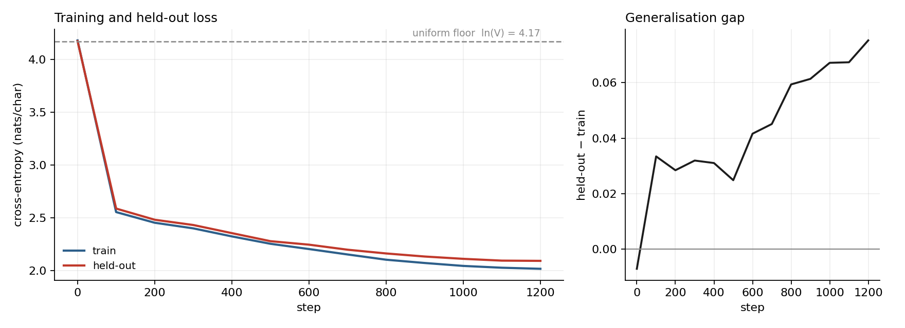
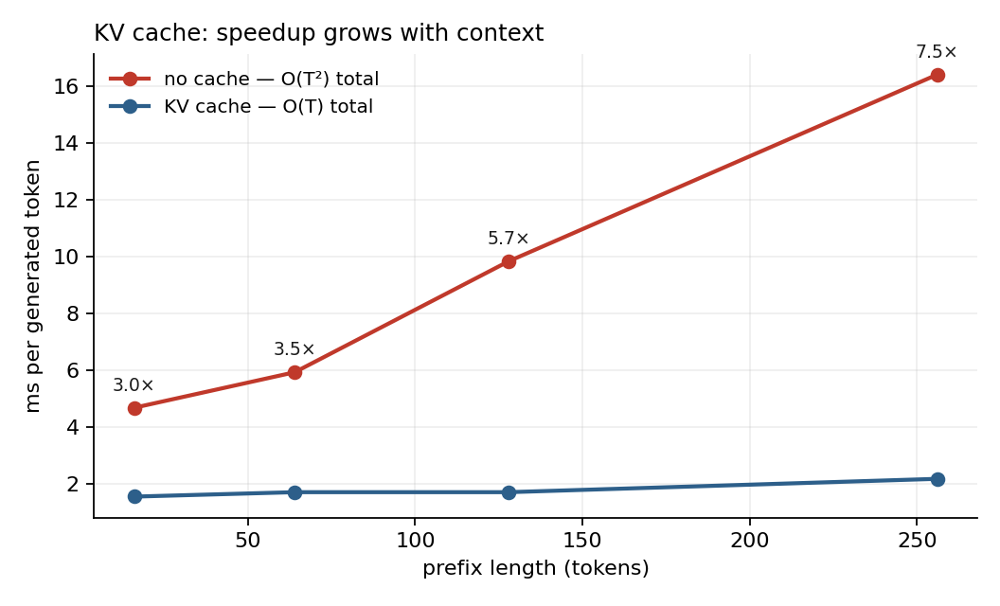

# Transformer from primitives, then made faster

A decoder-only transformer written from matrix operations — no `nn.Transformer`, no
`nn.MultiheadAttention`, no HuggingFace — trained to convergence, then profiled and
optimised with every change measured.

The point is not that a small GPT can be built. Thousands of people have followed that
tutorial. The point is the three things that come after it: **asserting the
implementation is correct**, **measuring what each optimisation actually buys on the
hardware you have**, and **reporting the optimisations that made it worse**.

---

## 1. It trains

3.16M parameters, 4 layers, 4 heads, 256 embedding, 128 context, char-level
tiny-shakespeare. 1,200 steps, 8.3 minutes on 2 CPU threads.



| | step 0 | step 1200 |
|---|---|---|
| train | 4.183 | **2.015** |
| held-out | 4.176 | **2.090** |
| uniform floor `ln(65)` | 4.174 | — |

Starting at the uniform floor of 4.174 is not a coincidence — it is a test
(`test_untrained_loss_is_near_the_uniform_floor`). A correctly initialised model predicts
uniformly over the vocabulary before it has learned anything, and any other starting loss
means the output layer is mis-scaled. It is the cheapest initialisation bug detector there
is and it costs one assertion.

**The right-hand panel is the part I'd point at.** The generalisation gap is *negative* at
step 0, hovers around +0.03 through step 500, then climbs steadily to +0.075 and is still
climbing when the run ends. That model is beginning to memorise. A run reported at "val
loss 2.09" with no gap curve hides that completely, and the next person to extend the run
would be training past the useful point without knowing.

Sample at 1,200 steps, temperature 0.8, top-k 40:

```
s lant cors?

DUPIONT:
And a shis woist, shis tho buthou sthin of tit youere,
Thit so Menuredikes of youn thy she die him youn t
```

Not English. But it has learned the line structure, the all-caps speaker label followed by
a colon and a newline, plausible orthography, and word-length distribution. That is what
2.0 nats/char looks like, and saying so is more useful than implying the sample is better
than it is.

**Validation is a contiguous tail of the corpus, never a random split.** Randomly
splitting a character stream puts adjacent windows on both sides of the boundary — which
is [project 01](../01-leakage-audit/)'s leak wearing a different costume. It would make
the two curves track each other beautifully and mean nothing.

---

## 2. It's correct

Twelve tests. The three that matter:

**`test_manual_attention_matches_hand_computation`** — checks the mechanism against the
formula written out in the test itself, not against another library. If both the
implementation and the reference come from PyTorch, the test only proves consistency.

**`test_causality_future_tokens_cannot_change_the_past`** — perturb the final token and
assert every earlier logit is unchanged. This is the defining property of a causal model
and an off-by-one in the mask slice breaks it silently.

**`test_kv_cache_matches_full_forward`** — incremental decode with a cache must produce
logits numerically identical to recomputing the whole prefix. This is the one that earns
its place. A cache bug does not raise: it makes generation faster and subtly wrong, which
is *indistinguishable from a successful optimisation* unless you assert equivalence. Same
argument as project 01 — the dangerous failures are the flattering ones.

Both attention implementations are kept side by side and asserted equivalent:

```python
attn_impl = "manual"   # explicit QK^T / sqrt(d), masked softmax, weighted sum of V
attn_impl = "sdpa"     # F.scaled_dot_product_attention
```

`manual` shows the mechanism. `sdpa` is what you ship. The benchmark measures exactly
what the swap costs or buys, which is the only reason to have an opinion about it.

---

## 3. The KV cache, measured

Without a cache, every decode step re-attends over the whole prefix: O(T²) total work to
emit T tokens. With one, each step attends once over the cached keys and values: O(T).

So the speedup **grows with context length**, which is why quoting it at a single
sequence length is close to meaningless.



| prefix length | no cache | cached | speedup |
|---|---|---|---|
| 16 | 0.30 s | 0.10 s | 3.1× |
| 64 | 0.38 s | 0.11 s | 3.4× |
| 128 | 0.63 s | 0.11 s | 5.8× |
| 256 | 1.05 s | 0.14 s | **7.6×** |

64 generated tokens, best of 3, CPU. The cached column is nearly flat while the uncached
column grows with the prefix — which is the asymptotic claim showing up in wall-clock
time rather than in a comment.

---

## 4. The optimisations, including the ones that failed

**Hardware matters and is stated, because these numbers do not transfer.** 2 CPU threads,
no CUDA, PyTorch 2.14. Batch 8, context 128, 4 layers, 256 embedding, 12 timed steps
after 3 discarded warmup steps, median.

| Configuration | tok/s | vs baseline | p50 step |
|---|---|---|---|
| baseline: manual attention, fp32 | 6,565 | 1.00× | 156 ms |
| `scaled_dot_product_attention` | 7,014 | **1.07×** | 146 ms |
| SDPA + bf16 autocast | 2,200 | **0.34×** | 465 ms |
| SDPA + bf16 + fused AdamW | 2,284 | 0.35× | 448 ms |
| SDPA + bf16 + `torch.compile` | 2,311 | 0.35× | 443 ms |

### bf16 autocast made it three times slower

This is the most useful row in the table and it is a failure.

Mixed precision is close to free advice — it appears in every performance guide and on
most GPUs it is a straightforward win. On this CPU it is a **2.9× regression**. The reason
is that bf16 is only fast where there is hardware support for it (AMX, or AVX512-BF16).
Without that, autocast still inserts the cast operations at every boundary and then
executes the arithmetic in emulation, so you pay the conversion overhead and get none of
the throughput.

`torch.compile` recovers almost nothing on top of it: 0.34× → 0.35×. At this model size
the graph is small, the kernels are already the dominant cost, and there is no fusion win
big enough to notice. Compilation also cost roughly 40 seconds of warmup that the timing
loop correctly discards — which is itself the argument for discarding warmup, because
including it would have shown `torch.compile` as a 10× regression.

Fused AdamW is unavailable on CPU, so that row is measuring nothing but noise. It is kept
in the table, labelled, rather than deleted — a benchmark that only lists configurations
that worked is a benchmark whose negative results were removed.

**What I take from it:** the widely-repeated optimisation list is a list of *hypotheses*
about your hardware, not a list of improvements. Two of the four things I applied made
this slower. On an A100 the bf16 row almost certainly inverts and becomes the largest win
in the table — which is the point. Run the benchmark on the hardware you will deploy on,
or you are optimising someone else's machine.

### Three ways to get these numbers wrong

All three were in the first version of `bench.py`:

- **Not discarding warmup.** The first iterations include allocator warmup, autotuning,
  and the whole `torch.compile` graph build. Including them makes compile look
  catastrophic and everything else look slow.
- **Not synchronising CUDA before timing.** Kernel launches are asynchronous, so without
  `torch.cuda.synchronize()` you are measuring how fast Python can queue work. Costless
  here since there is no GPU, and completely wrong the moment there is one.
- **Reporting the mean.** Throughput has a long right tail from scheduler noise. The mean
  reports your worst outliers; the median reports the machine. Both p50 and p95 are in
  the JSON.

### Peak memory is reported as NaN on CPU, deliberately

On CUDA, `max_memory_allocated` is resettable and gives a clean per-configuration number.
On CPU the cheap equivalent is max RSS, which is **monotonic over the process lifetime** —
so every row after the first would report the high-water mark of all preceding rows. My
first run did exactly that and printed an identical 889 MB for four different
configurations, which is a tell that the instrument is broken rather than that the
configurations use identical memory.

Reporting a number you know to be meaningless is worse than reporting no number, so it
returns NaN and this paragraph explains it. Doing it properly means one subprocess per
configuration, which is worth the complexity when memory is the question and not when
throughput is.

---

## Running it

```bash
pip install -r requirements.txt

python -m src.train --steps 1200            # ~8 min on 2 CPU threads
python -m src.bench --steps 12              # the optimisation table
python -m src.decode_bench --new-tokens 64  # KV cache sweep
python -m src.figures                       # regenerate both figures
pytest tests/ -v                            # 12 correctness tests
```

The corpus downloads tiny-shakespeare on first run and falls back to a deterministic
synthetic grammar if there is no network, so a fresh clone and CI both work offline.
Everything here runs on CPU. On a GPU, raise `--n-layer`, `--n-embd` and `--batch-size`
until the bf16 row starts winning.

---

## What I'd do next

- **Rerun the table on an A100.** The interesting question is not whether bf16 helps — it
  is the crossover point in model size where it starts to.
- **A Triton kernel.** Fused layer norm, benchmarked against the native op across
  sequence lengths, reporting the regime where native wins.
- **RoPE instead of learned positional embeddings**, with the effect on held-out loss
  reported honestly including if it is nil at this scale, which it may well be.
- **Stop the run where the gap curve turns.** Around step 500–600 by the look of it.
  Worth confirming with a longer run before believing the eyeball.
